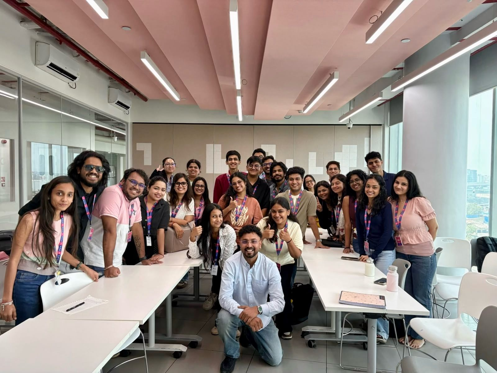
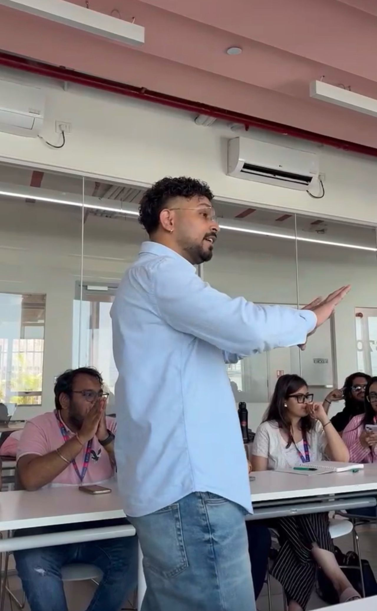
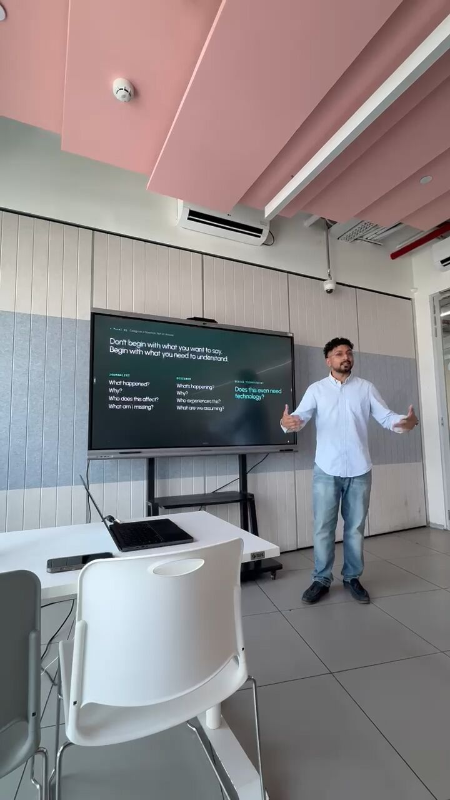

Going back to ISDI Mumbai as an alumnus was equal parts nostalgic and exciting, especially getting to meet some of my professors again. I stood where they once stood and told the students the only thing I'm sure of: nobody plans a career like mine. You just stay curious enough to follow the next question.

I've also been invited back to ATLAS SkillTech University as an industry alumnus for their Board of Studies, because Generation Alpha is now walking into post-grad classrooms.
