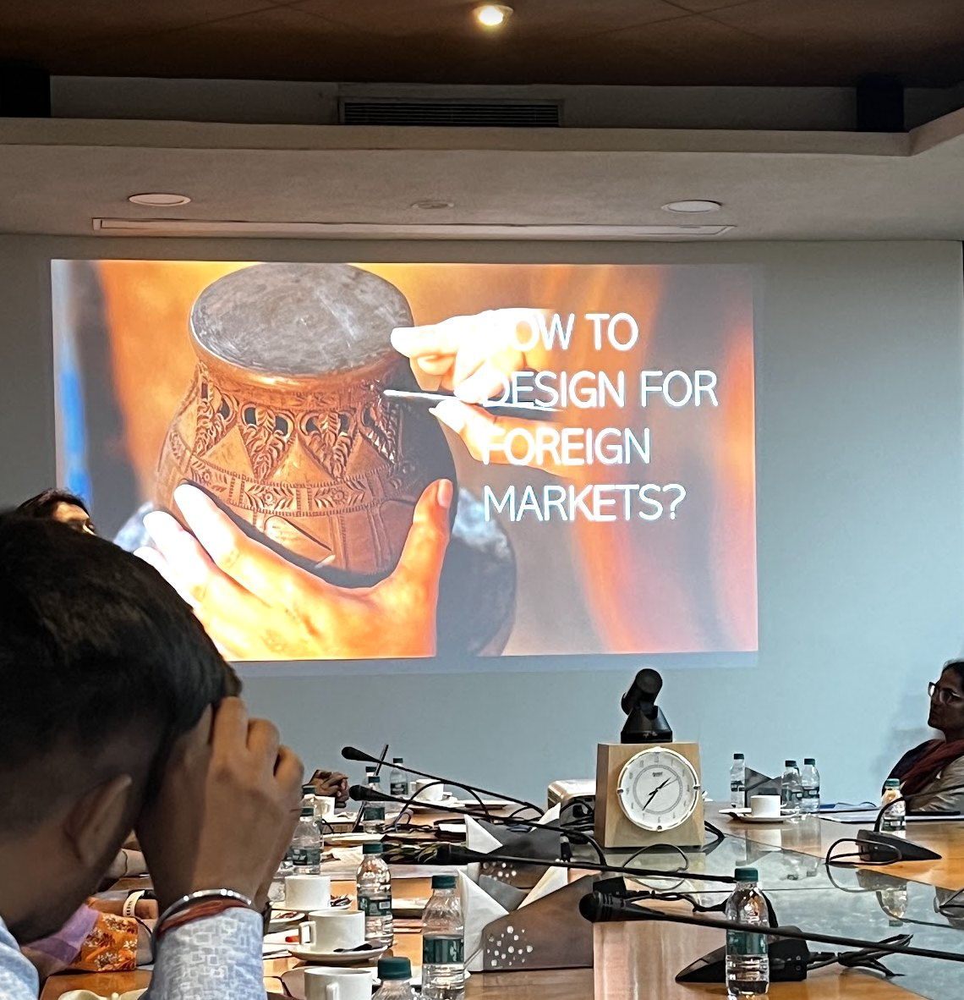

## The question

How do you design for five departments when none of them speak design?

## What I found

ExpoBazaar onboarded artisans from across India to sell to the world. I was the only designer for a year and a half, working with merchandising, development, the VP of Tech, project management and marketing. So I learned to speak their languages.

## What I tried

I designed role-specific dashboards for three B2B platforms serving more than 200 global buyers across Europe, the USA and Australia, and I brought in structured design-to-development handoffs and accessibility audits.

## What it became

Supplier engagement rose by 25%, and QA cycles dropped by 20%. That first number won the argument faster than any design rationale ever did.

## The next question

What else gets easier once a number does the arguing for you?
