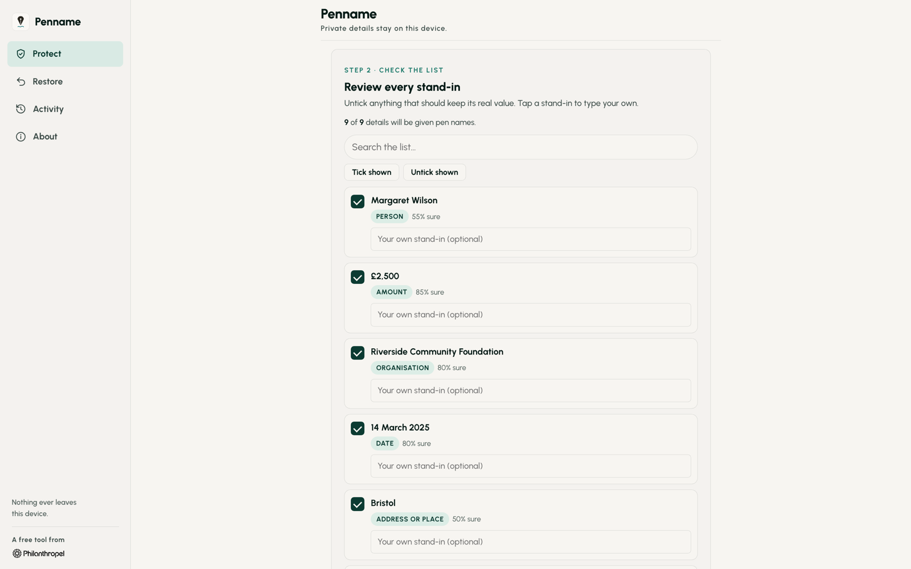
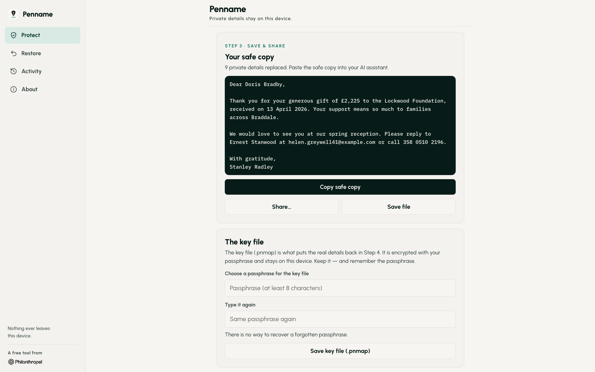

## The question

How do you use AI on a donor letter without handing over the donor?

## What I found

Everything gets pasted into AI now, and that includes the donor letters, client notes and patient records nobody meant to share. Teams end up with two bad choices: retype the document to strip out the names, or paste it in and hope.

## What I tried

Penname gives every private detail in a document a convincing stand-in before you share it with ChatGPT, Claude or Copilot, then puts the real details back when you're done. Margaret Wilson becomes Dorothy Fields. $25,000 becomes $22,500. You paste the AI's reply back into Penname and every pen name turns back into the real detail.

It runs entirely on your device. There's no internet connection, no AI service and no account. The small model that spots names runs offline, and the key file that restores the real details is encrypted and stays with you.

I built it for charities first, so it understands donor records, wealth ratings and appeal codes, and it reads exports from Raiser's Edge NXT, Salesforce NPSP, DonorPerfect, Bloomerang and Little Green Light. The same problem exists in every team using AI.

## What it became

Version 1.0 launched on 25 October 2026 for iPhone, iPad, Mac, Android and Windows. It's free, and the code is open source so the security can be checked.

Penname reduces how much personal data you share. It doesn't make data anonymous, and on its own it doesn't make anyone compliant. That line is on the product page too, because it's true.

## The next question

If the private details never have to leave the document, what else could you safely ask AI to do?
